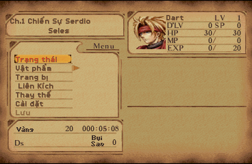
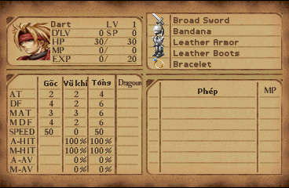
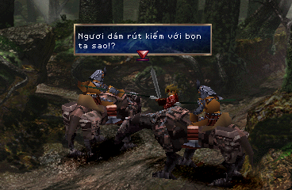
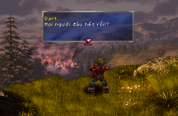
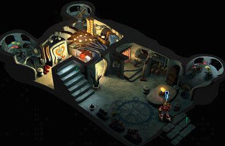
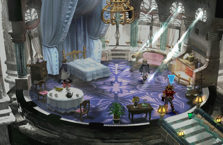

# The Legend of Dragoon — bản dịch tiếng Việt

Bản vá (patch) Việt hoá cho trò chơi PlayStation 1 *The Legend of Dragoon*
(Sony Computer Entertainment, 2000, bản Mỹ **SCUS-94491/94584/94585/94586**, 4 đĩa).

Đây là dự án của người hâm mộ, không liên quan tới Sony. Gói này **không
chứa** đĩa gốc hay bất kỳ dữ liệu nào của trò chơi. Bạn cần có ảnh đĩa gốc của
chính mình; bản vá chỉ ghi phần chữ tiếng Việt, phông chữ và vài byte mã điều
chỉnh lên ảnh đĩa đó.

## Tóm tắt 5 bước

1. Tải cả gói về (mục 0).
2. Kiểm 4 đĩa gốc Mỹ của bạn có SHA-256 đúng như bảng mục 2.
3. Áp **file `.ppf` của đúng đĩa** lên **bản sao của đĩa gốc đó** (mục 3 hoặc 4):
   đĩa 1 dùng `LoD-Disc1-vi.ppf`, đĩa 2 dùng `LoD-Disc2-vi.ppf`…
4. Kiểm SHA-256 đĩa ra theo bảng mục 5.
5. Mở file `.cue` của đĩa 1 bằng giả lập; tới lúc game yêu cầu thì đổi sang đĩa 2, 3, 4 đã vá.

## Bản vá

Mỗi đĩa có **một** file vá riêng; phải vá đủ cả 4 đĩa để chơi hết game.

| Đĩa | File cần tải | Mã đĩa | SHA-256 đĩa ra bắt đầu bằng |
|---|---|---|---|
| 1 | `LoD-Disc1-vi.ppf` | SCUS-94491 | `a5a68030` |
| 2 | `LoD-Disc2-vi.ppf` | SCUS-94584 | `b6c27f9d` |
| 3 | `LoD-Disc3-vi.ppf` | SCUS-94585 | `1783cb68` |
| 4 | `LoD-Disc4-vi.ppf` | SCUS-94586 | `78cfe43e` |

Quy tắc quan trọng, tránh nhầm:

- **Áp đúng file cho đúng đĩa.** File của đĩa 2 áp lên đĩa 1 sẽ hỏng đĩa.
- **Luôn áp lên đĩa gốc Mỹ chưa sửa**, không áp lên đĩa đã vá trước đó (kể cả
  bản vá cũ của dự án này). Muốn cập nhật thì lấy lại bản sao mới của đĩa gốc.
- Nên đặt tên đĩa ra là `The Legend of Dragoon (Disc 1) (VN).bin` …
  `The Legend of Dragoon (Disc 4) (VN).bin` (cách Python ở mục 4 tự đặt tên này).

Đã dịch: toàn bộ lời thoại (hơn 12.000 câu, xưng hô theo từng nhân vật), menu,
tên và mô tả vật phẩm, phép, thông báo trong trận, chữ vẽ sẵn trong hình (menu
màn tựa, nhãn menu, tiêu đề 4 chương). Addition dịch là **Liên Kích**.
Giữ tiếng Anh: tên nhân vật, **tên trang bị** (vũ khí, giáp, mũ, giày, phụ
kiện), **tên kỹ năng Liên Kích** (Double Slash, Volcano… cho khớp chữ hiện lúc ra
đòn), phim (FMV), màn "PLEASE INSERT DISC".

Các file khác trong gói:

| File | Dùng để |
|---|---|
| `apply_patch.py` | Trình áp vá bằng Python, tự nhận đĩa, tự kiểm SHA-256 trước và sau, tự tạo `.cue` (mục 4) |
| `tao_cue.bat` | Tạo file `.cue` đúng tên cho file `.bin` (kéo thả hoặc nháy đúp, mục 5) |
| `README.md` | Hướng dẫn này |

---

## Hình ảnh

| | |
|---|---|
|  |  |
| Menu trong game: Trạng thái / Vật phẩm / Trang bị / Liên Kích… | Bảng trạng thái, tên trang bị giữ tiếng Anh |
|  |  |
| Hội thoại đầu game | Tên người nói tách dòng riêng |
|  |  |
| Đĩa 2 | Đĩa 3 |

## 0. Tải file về

- **Tải cả gói (dễ nhất):** trên trang repo, bấm nút xanh **Code** →
  **Download ZIP**, rồi giải nén. Bạn có đủ 4 file `.ppf`, `apply_patch.py`
  và `tao_cue.bat`.
- **Tải riêng từng file:** bấm vào tên file trong danh sách (ví dụ
  `LoD-Disc1-vi.ppf`), rồi bấm nút **tải xuống** (mũi tên ⤓ ở góc phải,
  cạnh nút *Raw*). Đừng dùng chuột phải → "Lưu liên kết": cách đó tải về trang
  web chứ không phải file vá.

Kiểm kích thước sau khi tải: mỗi file `.ppf` khoảng **1,8–2,8 MB**. Nếu chỉ vài
KB hoặc mở ra thấy chữ HTML thì bạn đã tải nhầm trang web, tải lại.

## 1. Chuẩn bị ảnh đĩa gốc

Bạn cần ảnh đĩa dạng **`.bin` + `.cue`** (Mode 2, 2352 byte mỗi sector) của
4 đĩa bản Mỹ. Đây là định dạng mà các phần mềm đọc đĩa PS1 phổ biến (ImgBurn,
CDRDAO, Alcohol 120%…) xuất ra khi chọn kiểu "BIN/CUE". Một số lưu ý:

- Mỗi đĩa phải có **đúng một file `.bin`**. Nếu `.cue` liệt kê nhiều file
  (Track 01, Track 02…), đó là kiểu chia track, không dùng trực tiếp được.
- File `.iso` (2048 byte mỗi sector) **không** dùng được: bản vá tính theo
  sector 2352 byte có mã sửa lỗi.
- Kích thước đúng của từng `.bin`:

| Đĩa | Kích thước `.bin` gốc |
|---|---|
| 1 | 484.951.824 byte |
| 2 | 576.009.504 byte |
| 3 | 559.173.888 byte |
| 4 | 748.204.128 byte |

Bản vá được tạo từ đúng các ảnh đĩa này (bản Redump); ảnh khác dù "cùng game"
cũng có thể lệch vài byte. Vì vậy phải kiểm SHA-256 trước khi áp.

## 2. Kiểm SHA-256 của ảnh đĩa gốc

SHA-256 là "dấu vân tay" của file: hai file giống nhau từng byte thì ra cùng
một chuỗi 64 ký tự. Ảnh đĩa gốc phải cho ra đúng:

| Đĩa | SHA-256 đĩa gốc (Mỹ) |
|---|---|
| 1 | `049393ab69cfd66a12750158098358e8735628a75e2c517e0336e55bbcb67848` |
| 2 | `cfbfcfda1283e85516efd73a60c74d4f44389f7dec7e1c39b6653052ab015ce8` |
| 3 | `445aa8f320b33e1703c744a63ad4efc797fa9c87bda30774f88402c0311c65ac` |
| 4 | `205909877b0fe5fc40905f7cf6dd61dbd735f2670f3346ccf719f7fdaf3aa744` |

Cách tính trên từng hệ điều hành (thay `TEN_FILE.bin` bằng tên file của bạn;
nếu đường dẫn có khoảng trắng thì đặt trong dấu ngoặc kép):

**Windows, dùng Command Prompt (cmd):**

```
certutil -hashfile "TEN_FILE.bin" SHA256
```

Mở cmd bằng cách gõ `cmd` vào ô tìm kiếm của Start; dùng lệnh `cd` để vào thư
mục chứa file, hoặc kéo thả file vào cửa sổ cmd để dán đường dẫn. Kết quả hiện
ở dòng thứ hai, có thể có khoảng trắng giữa các cặp ký tự, cứ bỏ khoảng trắng
mà so.

**Windows, dùng PowerShell:**

```
Get-FileHash "TEN_FILE.bin" -Algorithm SHA256
```

Cột `Hash` là kết quả (chữ in hoa, so không phân biệt hoa thường).

**macOS (Terminal):**

```
shasum -a 256 "TEN_FILE.bin"
```

**Linux:**

```
sha256sum "TEN_FILE.bin"
```

Mỗi đĩa vài trăm MB nên tính mất vài giây. Chỉ cần so **8 ký tự đầu** là đủ để
nhận ra. Nếu khác, xem mục 6.

## 3. Áp vá — cách 1: PPF-O-Matic (Windows, không cần cài gì)

PPF-O-Matic là công cụ nhỏ, miễn phí, chuyên áp bản vá PPF cho đĩa PS1; tìm
"PPF-O-Matic 3" trên các trang lưu trữ công cụ ROM hacking.

1. **Sao chép** file `.bin` gốc của đĩa ra một bản khác và đổi tên theo bảng
   dưới. PPF-O-Matic sửa thẳng vào file được chọn, nên **luôn giữ lại file gốc**
   không đụng tới.
2. Mở PPF-O-Matic. Ô **ISO file**: chọn bản sao vừa tạo. Ô **Patch**: chọn file
   `.ppf` của **đúng đĩa** đó.
3. Bấm **Apply**. Chỉ vài giây, chương trình báo "Successfully patched".
   Ô mô tả của PPF-O-Matic hiện tên bản vá (cột cuối bảng dưới); đúng số đĩa
   thì bạn đã chọn đúng file.
4. Làm lại từ bước 1 cho từng đĩa còn lại, rồi tạo `.cue` và kiểm kết quả theo mục 5.

| Đĩa | Tên bản sao nên đặt | Ô **Patch** chọn | PPF-O-Matic hiện mô tả |
|---|---|---|---|
| 1 | `The Legend of Dragoon (Disc 1) (VN).bin` | `LoD-Disc1-vi.ppf` | `Legend of Dragoon VN - Disc 1` |
| 2 | `The Legend of Dragoon (Disc 2) (VN).bin` | `LoD-Disc2-vi.ppf` | `Legend of Dragoon VN - Disc 2` |
| 3 | `The Legend of Dragoon (Disc 3) (VN).bin` | `LoD-Disc3-vi.ppf` | `Legend of Dragoon VN - Disc 3` |
| 4 | `The Legend of Dragoon (Disc 4) (VN).bin` | `LoD-Disc4-vi.ppf` | `Legend of Dragoon VN - Disc 4` |

## 4. Áp vá — cách 2: Python (Windows, macOS, Linux)

Cần Python 3 (tải từ python.org; trên Windows khi cài nhớ tick "Add Python to
PATH"). Cách này **không sửa** file gốc mà tạo file mới, tự nhận đĩa, tự kiểm
SHA-256 và tự tạo luôn file `.cue`.

1. Đặt `apply_patch.py` và 4 file `.ppf` vào cùng một thư mục (giữ nguyên tên file).
2. Mở cửa sổ lệnh tại thư mục đó. Windows: mở thư mục trong File Explorer, bấm
   vào thanh địa chỉ, gõ `cmd` rồi Enter. macOS/Linux: mở Terminal tại thư mục.
3. Chạy lệnh cho từng đĩa (thay đường dẫn bằng file `.bin` gốc của bạn, giữ
   nguyên dấu ngoặc kép):

```
python apply_patch.py "Legend of Dragoon, The (USA) (Disc 1).bin"
python apply_patch.py "Legend of Dragoon, The (USA) (Disc 2).bin"
python apply_patch.py "Legend of Dragoon, The (USA) (Disc 3).bin"
python apply_patch.py "Legend of Dragoon, The (USA) (Disc 4).bin"
```

Trên macOS/Linux nếu báo không có `python` thì dùng `python3`. Script tự nhận
đây là đĩa số mấy, nên không cần chỉ file `.ppf`.

4. Đọc các dòng lệnh in ra:

| Dòng in ra | Nghĩa |
|---|---|
| `Xong! Đã tạo:` kèm tên file `.bin` và `.cue` | Xong đĩa đó, đĩa ra đúng SHA-256 |
| `Không nhận ra đĩa (SHA-256 ...)` | Đĩa gốc sai, chưa ghi gì; xem mục 6 |
| `LỖI: kết quả không khớp SHA-256 mong đợi. Đã xoá file hỏng.` | Đĩa ra sai (file `.ppf` hỏng hoặc sai); tải lại theo mục 0 |
| `File PPF hỏng` | File `.ppf` tải hỏng (thường là tải nhầm trang web); tải lại theo mục 0 |

File ra được ghi **cạnh file gốc**, tên `The Legend of Dragoon (Disc N) (VN).bin`
kèm `.cue` cùng tên, bỏ qua phần tạo `.cue` ở mục 5.

## 5. Kiểm kết quả

Tính SHA-256 của từng file đã vá (cùng cách ở mục 2) và so với **đúng dòng của đĩa**:

| Đĩa | SHA-256 đĩa ra |
|---|---|
| 1 | `a5a680300bac216d9852b6ac5913dad67b939153d1122cdd2feef9ea87a98200` |
| 2 | `b6c27f9dfa5b894a8d493289f4a0ac4452c87bb41bbcef06ba49394eda83ff63` |
| 3 | `1783cb68b7eb8dca422058f3bf0ad40bab2ba1351c9bb8a964f2698cfaa0eb7c` |
| 4 | `78cfe43eb12d539a884d56a47535632109987f5850575bd14217329058dd6bc3` |

Chỉ cần so 8 ký tự đầu. Đúng chuỗi này thì file của bạn giống từng byte với bản
đã được kiểm thử; mọi lỗi nếu có sẽ không phải do bước áp vá. Đĩa đã vá có
**cùng kích thước** với đĩa gốc.

Nếu áp bằng PPF-O-Matic thì cần thêm file `.cue` cho đĩa mới (cách Python đã
tự tạo sẵn). Nhanh nhất: **kéo thả file `.bin` đã vá lên `tao_cue.bat`**, hoặc
chép `tao_cue.bat` vào cùng thư mục rồi nháy đúp — nó tạo `.cue` đúng tên cho
mọi file `.bin` ở đó. Muốn làm tay thì tạo file văn bản cùng tên với file
`.bin` nhưng đuôi `.cue` (ví dụ `The Legend of Dragoon (Disc 1) (VN).cue`), nội
dung ba dòng, dòng đầu ghi **đúng tên file `.bin`** của bạn:

```
FILE "The Legend of Dragoon (Disc 1) (VN).bin" BINARY
  TRACK 01 MODE2/2352
    INDEX 01 00:00:00
```

## 6. Khi SHA-256 không khớp

- **Ảnh gốc ra chuỗi khác bảng mục 2:** ảnh đĩa của bạn không phải bản mà bản
  vá được tạo từ đó. Nguyên nhân hay gặp: đọc đĩa ra kiểu `.iso` 2048 byte
  (kích thước sẽ nhỏ hơn nhiều), đọc thiếu hoặc thừa sector cuối, đĩa thuộc bản
  in khác (bản châu Âu/Nhật, bản Greatest Hits…), hoặc file từng bị áp một bản
  vá khác. Cách chắc nhất là đọc lại từ đĩa thật bằng ImgBurn ở chế độ BIN/CUE.
- **Ảnh đã vá không khớp bảng mục 5:** bạn đã áp lên ảnh gốc sai (xem trên),
  áp nhầm file `.ppf` của đĩa khác, hoặc áp lên một file đã vá trước đó. Làm lại
  từ một bản sao mới của đĩa gốc, chỉ áp đúng một file `.ppf`.

## 7. Chạy trên giả lập

Mở file **`.cue`** (không phải `.bin`) bằng giả lập. Đã thử trên DuckStation và
PCSX-Redux; ePSXe, Mednafen/Beetle PSX đều đọc được BIN/CUE.

- **Đổi đĩa:** hết đĩa 1, game yêu cầu "PLEASE INSERT DISC 2" → dùng chức năng
  đổi đĩa của giả lập (DuckStation: *System → Change Disc*) chọn file `.cue` của
  **đĩa 2 đã vá**. Không trộn đĩa gốc với đĩa đã vá.
- Thẻ nhớ (save trong game) dùng bình thường, kể cả save của bản gốc Mỹ.
- **Không nạp save state** (lưu nhanh của giả lập, kiểu F1/F2) được tạo trên
  bản gốc hay bản dịch cũ: save state giữ nguyên toàn bộ bộ nhớ lúc lưu, nên
  vẫn hiện chữ cũ và có thể mang theo lỗi cũ (ví dụ lỗi đứng máy khi ra đòn của
  bản trước 6/10/2026) dù đĩa mới đã đúng. Vào game bằng "Continue" từ thẻ nhớ.

> **Cập nhật 8/10/2026 (v1.3):**
> - Sửa **kẹt không điều khiển được** khi vào nhà tù Hellena.
> - Sửa **sập game ở trận Fruegel** (và các khung thoại khác trong trận/phim).
> - Sửa chữ bị lẫn nét ở núi lửa Villude, khu rừng.
> - Cửa hiệu và menu lựa chọn: vạch chọn không còn lệch dòng.
> - Dịch thêm **hơn 1.200 câu** trước đây còn tiếng Anh: hướng dẫn chiến đấu của
>   Lavitz, cảnh gặp Lavitz trong nhà tù, thoại NPC Fletz, Donau, lâu đài Tiberoa
>   (đĩa 2), Miranda và Nữ hoàng Theresa (đĩa 3), Savan, Ulara và Charle (đĩa 4)…
> - Tên vùng trên bản đồ thế giới bằng tiếng Việt; khung tên địa điểm cân đối.
> - Tên kỹ năng Liên Kích giữ tiếng Anh cho khớp chữ trong trận.
> - Cửa hàng: chữ "Đang có" không còn che mất số lượng.
>
> **Cập nhật 6/10/2026 (v1.2):**
> - Sửa **đứng máy khi ra đòn trong trận**.
> - Sửa chữ tràn khung / xuống dòng giữa chữ; tên người nói luôn nằm dòng riêng.
> - Addition đổi thành "Liên Kích"; tên trang bị giữ tiếng Anh.
> - Đĩa đã vá không còn dài hơn đĩa gốc.
>
> Đĩa làm từ bản cũ: tải lại 4 file `.ppf` và áp lại lên **đĩa gốc Mỹ**. Thẻ
> nhớ dùng tiếp bình thường; save state cũ thì bỏ.

## 8. Câu hỏi thường gặp

**Có thể dùng bản vá xdelta không?** Gói này phát hành PPF vì là chuẩn lâu năm
cho PS1. Ai có sẵn hai ảnh đĩa có thể tự tạo xdelta bằng xdelta UI, kết quả
tương đương.

**Tại sao phải kiểm SHA-256 kỹ vậy?** Vì các lỗi khó chịu nhất (đứng máy, chữ
rác) từng bắt nguồn từ chỉ vài byte lệch. Kiểm hash là cách duy nhất biết chắc
file của bạn giống file đã được thử.

**Tại sao tên trang bị vẫn là tiếng Anh?** Tạm thời giữ nguyên để dễ tra cứu
với tài liệu hướng dẫn và cộng đồng; có thể dịch ở bản sau.

**Báo lỗi ở đâu?** Mở issue trên repo này, kèm: SHA-256 của file đã vá, số đĩa,
tên giả lập, và ảnh chụp màn hình cùng câu thoại cuối cùng trước khi lỗi.

## 9. Bản quyền

Trò chơi, tên gọi, hình ảnh và âm thanh thuộc Sony Interactive Entertainment
và các chủ sở hữu liên quan. Bản vá chỉ chứa phần chữ dịch, phông chữ vẽ lại và
các byte mã điều chỉnh, không phân phối dữ liệu gốc. Nếu chủ sở hữu bản quyền
yêu cầu, bản vá sẽ được gỡ.

---

Bản dịch do **Khuong Doan** thực hiện — <https://khuongdoan.com/>

<sub>Bản vá miễn phí và sẽ luôn như vậy. Nếu nó giúp bạn chơi lại trò chơi tuổi thơ và bạn muốn mời tác giả một ly cà phê, quét mã MoMo bên dưới. Không bắt buộc, không kèm quyền lợi gì thêm.</sub>

<a href="https://github.com/2ez4gcx/Project-hub/blob/main/docs/anh/ung-ho-momo.png"></a>
