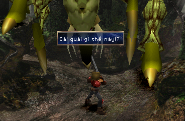

# The Legend of Dragoon — Bản Việt hoá

Bản vá tiếng Việt có dấu đầy đủ cho **The Legend of Dragoon (USA)** trên PlayStation, cả 4 đĩa.

 

## Đã dịch
- Toàn bộ lời thoại cốt truyện, NPC, hướng dẫn, thông báo trong trận (hơn 12.000 câu), xưng hô theo từng nhân vật.
- Menu, tên vật phẩm, phép, mô tả vật phẩm và trang bị. Addition = **Liên Kích**.
- Font chữ vẽ lại có dấu tiếng Việt, độ rộng chữ thay đổi theo ký tự; hộp thoại tự ngắt dòng.
- Chữ vẽ sẵn đã vẽ lại: menu màn hình chính, nhãn menu trong game (Vàng, Gốc, Vũ khí, Tổng…; giữ viết tắt HP/MP/AT…), tiêu đề 4 chương.

Giữ nguyên tiếng Anh: tên nhân vật (Dart, Shana, Lavitz, Rose…), **tên trang bị** (vũ khí, giáp, mũ, giày, phụ kiện),
phim (FMV), màn "PLEASE INSERT DISC".

## Cách áp bản vá

Cần đĩa gốc **The Legend of Dragoon (USA)** dạng `.bin` một track (bản Redump), đúng SHA-256 bên dưới.
Bản vá giữ nguyên kích thước đĩa.

### Cách 1: `apply_patch.py` (khuyên dùng)
Cần Python 3. Chạy cho từng đĩa:
```
python apply_patch.py "Legend of Dragoon, The (USA) (Disc 1).bin"
```
Script tự nhận đĩa, áp bản vá, kiểm tra kết quả và tạo sẵn file `.cue`.

### Cách 2: PPF-O-Matic
Áp `LoD-DiscN-vi.ppf` lên đúng đĩa N, rồi kéo thả file `.bin` đã vá lên `tao_cue.bat` để tạo file `.cue`.

## SHA-256

| Đĩa | Gốc (USA) | Sau khi vá |
|---|---|---|
| 1 | `049393ab69cfd66a12750158098358e8735628a75e2c517e0336e55bbcb67848` | `8e911abd2651e50dd036fd6b28ec3f3fbeb5f77c57061d9267fc1ccf79b3050a` |
| 2 | `cfbfcfda1283e85516efd73a60c74d4f44389f7dec7e1c39b6653052ab015ce8` | `11dd172ab919ae5d79cfaed1e5a8d89fe5eddd9b0fc570175c00aa72f6fe355a` |
| 3 | `445aa8f320b33e1703c744a63ad4efc797fa9c87bda30774f88402c0311c65ac` | `ebff8095715893819193759ca2c7388e3d8c249d8836c32c90089ee8846c9553` |
| 4 | `205909877b0fe5fc40905f7cf6dd61dbd735f2670f3346ccf719f7fdaf3aa744` | `278b9d483121ab5b2c7f3fbb1e61f9216431987fb1793c4f36ee23abb50d5202` |

## Lưu ý
- Save của bản gốc USA dùng được với bản Việt hoá; chơi hết đĩa 1 rồi đổi sang đĩa 2, 3, 4 (đã vá) như bình thường.
- Đã thử trên DuckStation và PCSX-Redux. Nếu gặp lỗi, hãy báo kèm ảnh chụp và vị trí trong game.

## Lịch sử phiên bản
- **v1.2** — Sửa đứng máy khi ra đòn trong trận; sửa chữ tràn khung / xuống dòng giữa chữ; tên người nói luôn nằm
  dòng riêng; Addition đổi thành "Liên Kích"; tên trang bị giữ tiếng Anh; bản vá không còn làm đĩa dài ra.
- **v1.1** — Vẽ lại chữ trong hình (menu tiêu đề, nhãn menu, tiêu đề chương); hộp thoại vừa khít chữ; menu thẳng cột.
- **v1.0** — Dịch toàn bộ lời thoại 4 đĩa, menu, vật phẩm, font tiếng Việt.
